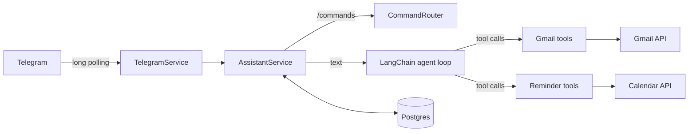

# Tempo

A private, self-hosted personal assistant that lives in Telegram. Chat with it in plain language and it works with
your Gmail and Google Calendar for you: it finds and reads email, drafts replies, and sets reminders, without sending
anything you have not reviewed.

Built with TypeScript on Bun, LangChain with OpenAI tool calling, and Postgres.

## What it can do

- **Chat with memory.** Conversation history is kept per user in Postgres; `/reset` clears it.
- **Gmail.** Search and read your inbox, summarize threads, and draft new emails or replies that land in the right
  thread. The bot shows a preview of the real draft, flags first-time recipients, and sends it only when you reply
  `/send`.
- **Reminders.** "Remind me every weekday at 8:30 to check standup" becomes a Google Calendar event with a popup at
  that time. List and cancel reminders from the chat. Repeats: daily, weekdays, weekly, monthly.
- **Timezone-aware.** Set your zone once with `/timezone Europe/Paris`; relative times ("tomorrow at 9", "in 2 hours")
  are resolved in it, daylight saving included.
- **Private by default.** Only allowlisted Telegram users get answers. Everyone else gets one "This bot is private."
  and then silence.

### Commands

| Command | What it does |
| --- | --- |
| `/connect` | Link your Google account (Gmail and Calendar) |
| `/send` | Send the draft from the last preview |
| `/timezone [Area/City]` | Show or set your timezone |
| `/reset` | Clear the conversation history |

## How it works



1. A message arrives through Telegram long polling; non-allowlisted senders are dropped.
2. Slash commands go to a command router. Everything else goes to an agent loop (OpenAI tool calling, capped at five
   steps) with the last 40 messages of history and a system prompt that knows your local time.
3. Tools are built per request with the current user, so every Google call uses that user's own OAuth credentials.
4. The reply is saved and sent; tool-generated messages (draft previews, reminder confirmations) follow it.

## Security design

The assistant reads untrusted content (email bodies) with a model that can act on your account, so the dangerous
actions are kept out of the model's hands:

- **The model cannot send email.** It can only create drafts. Sending needs `/send`, a command handled by code,
  and only works for the draft whose preview was actually delivered to you, within an hour.
- **Previews and confirmations are built by code,** not written by the model, so what you see is what was created.
- **Email content is marked as untrusted data** in the prompt, and only ids and dates (never subjects or bodies) are
  kept in long-term history.
- **Reminders are sandboxed:** the bot only lists or cancels calendar events it tagged itself, and never adds
  attendees, so nobody else is ever invited or notified.
- **Google refresh tokens are encrypted at rest** (AES-256-GCM). The OAuth flow uses PKCE and single-use, expiring
  state. Logs carry error messages only, never tokens or message content.

## Tech stack

| Concern | Choice |
| --- | --- |
| Runtime, package manager, tests | [Bun](https://bun.sh) 1.3+ (TypeScript runs directly, no build step) |
| Chat | [grammY](https://grammy.dev) (Telegram Bot API) |
| LLM | [LangChain](https://js.langchain.com) + OpenAI (`gpt-4o`) with tool calling |
| Google | `google-auth-library`, `@googleapis/gmail`, `@googleapis/calendar` |
| HTTP | [Hono](https://hono.dev) on `Bun.serve` (health check, OAuth callback) |
| Data | Postgres with [TypeORM](https://typeorm.io) migrations |
| Validation, DI, logging | Zod 4, tsyringe, pino |
| Quality | Biome, husky pre-commit, `bun test` |

## Getting started

Requirements: Bun 1.3+, Postgres, an OpenAI API key and a Telegram bot token from
[@BotFather](https://t.me/BotFather).

```bash
cd backend
bun install
cp .env.example .env        # fill in OPENAI_API_KEY, TELEGRAM_BOT_TOKEN and DB_*
bun run migration migrate
bun run dev
```

Then allowlist yourself by inserting a `users` row with `is_allowed = true` and `telegram_id` set to your numeric
Telegram user id, and message your bot.

Gmail and reminders need a Google Cloud OAuth client and a public HTTPS URL for the OAuth callback (a tunnel such as
ngrok works locally). The full setup, including the `GOOGLE_*`, `TOKEN_ENCRYPTION_KEY` and `PUBLIC_BASE_URL`
variables, is in [backend/README.md](backend/README.md#google-account).

## Development

Run these from `backend/`:

| Command | Description |
| --- | --- |
| `bun run dev` | Run with hot reload |
| `bun test` | Run the test suite |
| `bun run typecheck` | Type-check with `tsc` |
| `bun run lint` | Lint and format check with Biome |
| `bun run migration <status\|generate\|create\|migrate\|rollback>` | Manage database migrations |

Project layout:

```
backend/src/
├── assistant/      # chat flow: commands, agent tools (Gmail, Calendar), prompts, history
├── common/         # shared infra: env, DB, DI tokens, errors, logger
│   └── integrations/   # Telegram, LangChain, Google OAuth
└── migrations/
```

## Status

A personal project, built for a single user and run as one process. Planned next: deployment to AWS EC2, then job
listing search and general calendar tools.
